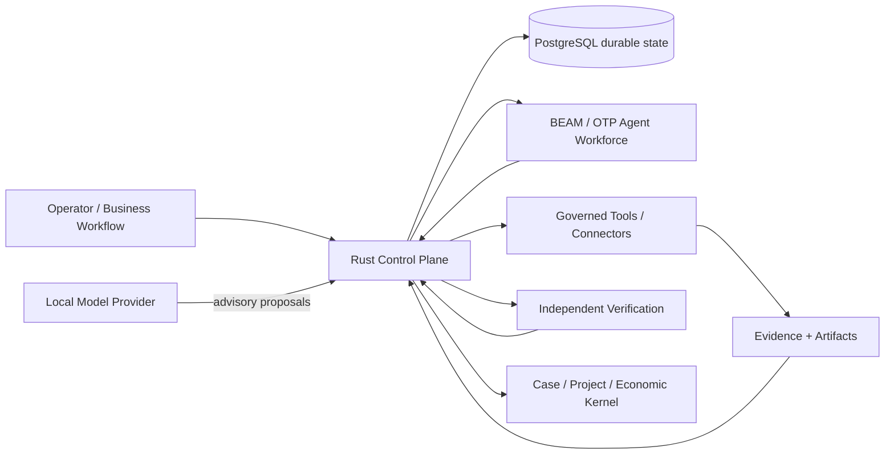

# Agent Lifecycle Plane

> **Governed autonomy for real work.**
>
> Run agent-powered business workflows without giving models the keys.

Agent Lifecycle Plane is a **local-first control plane for governed autonomous work**. It keeps business process, authority, evidence, supervision, economics, and runtime state outside the model so that an LLM can propose actions without becoming the authority that approves or verifies them.

The v0.1 line is intentionally narrow: **single-tenant, local-first, and operator-controlled**. It is built for experimentation, solopreneurs, startups, small teams, and controlled internal environments—not public-internet multi-tenant SaaS.

## Why Agent Lifecycle Plane

Most agent frameworks focus on what an agent can do. Agent Lifecycle Plane focuses on:

- **who** is allowed to do it;
- **under what authority**;
- **against which durable workflow and budget**;
- **with what evidence and audit trail**;
- **who independently verifies the result**; and
- **what happens when work fails, stalls, exceeds policy, or needs escalation**.

The core rule is simple:

> **Models propose. Deterministic policy and independent verification authorize.**

## What is implemented in v0.1

- Rust control plane with PostgreSQL durable state
- BEAM/OTP supervised agent workforce and crash recovery
- capability-based principals and governed task execution
- durable orchestration, leases, retries, reconciliation, and verification
- governed HTTPS research tools with allowlists, evidence hashing, size limits, and redirect denial
- local cognition through Ollama and OpenAI-compatible local endpoints
- generic workflow / case / work-item company kernel
- project dates, participants, resources, budgets, and supervisor scoring
- agent workplace performance events
- portable company blueprints with redacted/public export modes
- sandbox/shadow replay with side effects disabled
- connector and source-of-truth mappings
- budgets, commitments, invoices, payment intents, and balanced journal entries
- terminal-native Company Studio built with Ratatui
- four end-to-end reference-company scenarios

## Architecture



The model is never the source of authority. Durable state, policy checks, leases, evidence, supervisor review, and economic controls stay in the control plane.

See [`docs/architecture.md`](docs/architecture.md) for the detailed boundary model.

## First five minutes

### Prerequisites

- Docker with Compose v2
- Rust toolchain with `cargo`
- Python 3
- `curl`
- optional: Ollama for local cognition

Start the local control plane and let bootstrap generate a private database credential:

```bash
./bootstrap.sh
```

Check the machine, create a workspace, and inspect its architecture:

```bash
cargo run -p alp-cli -- doctor --system
cargo run -p alp-cli -- new my-company --template local
cd my-company
cargo run --manifest-path ../crates/alp-cli/Cargo.toml -- validate
cargo run --manifest-path ../crates/alp-cli/Cargo.toml -- tree
```

For the guided path:

```bash
cargo run -p alp-cli -- guide
```

For a normal developer install from the cloned repository:

```bash
cargo install --path crates/alp-cli --locked
cargo install --path crates/alp-studio --locked

alpctl --help
alpctl guide
alpctl studio
```

The CLI executable is named `alpctl` (the Cargo package remains `alp-cli`) to avoid colliding with unrelated tools that already use the short `alp` command.

By default, published host ports bind to `127.0.0.1`, security mode is local, and model policy is `local_only`.

## CLI

| Command | Purpose |
| --- | --- |
| `alpctl doctor --system` | inspect machine/runtime/model readiness |
| `alpctl new NAME --template local` | create a governed workspace |
| `alpctl validate` | validate `alp.yaml` and policy invariants |
| `alpctl tree` | explain the workspace architecture |
| `alpctl guide` | print the first-run guide and safety model |
| `alpctl studio` | launch Company Studio |
| `alpctl demo` | run all four end-to-end reference companies |
| `alpctl check` | run the full release-candidate gate |
| `alpctl check --public` | also validate the exact staged public tree |

## Company Studio

Company Studio is a real Ratatui terminal product surface, not a screenshot mock-up. It opens with an animated ASCII welcome screen and then connects to the live control plane.

Tabs:

- **RUN** — live cases and workflow state
- **DESIGN** — workflow graph/draft editor with mouse support
- **FINANCE** — case-scoped budgets and economics
- **SANDBOX** — blueprints and integration fabric
- **AGENTS** — workplace performance signals
- **AUDIT** — enforced architectural invariants

Global controls: `←/→` tabs, `r` refresh, `?` help, `q` quit. In DESIGN: `↑/↓` select workflow, `Enter` load, `a` add, `d` delete, `c` connect, `p` publish a new immutable version.

Skip the intro when scripting:

```bash
alp-studio --no-splash
```

## Reference companies

The same kernel is exercised against four materially different workflows:

| Scenario | What the gate proves |
| --- | --- |
| Managed support | governed delivery, supervision, revenue, cost, margin |
| Procurement | budget, commitment, AP, payment-intent authority separation |
| Enterprise transition | blueprint export/import, canonical mappings, shadow replay, no side effects |
| Project delivery | dates, participants, parallel work, budget, revenue, expense, margin |

Run them with either entrypoint:

```bash
alpctl demo
# or
bash scripts/alp14_reference_companies_gate.sh
```

See [`docs/reference-companies.md`](docs/reference-companies.md).

## Release gates

The product release candidate gate combines tests, Clippy, dependency audit, secret hygiene, container privilege assertions, API security checks, and the reference-company regression suite:

```bash
alpctl check
# or
bash scripts/alp17_release_candidate_gate.sh
```

Before a public commit or tag, run the staged-tree gate as well:

```bash
bash scripts/public_release_gate.sh
```

A release should not be tagged unless both gates finish GREEN.

## Security posture

v0.1 is a **local-first, single-tenant beta**. Local mode intentionally relies on loopback/container-boundary isolation rather than user authentication. Token mode is available for controlled local deployments, but this project does **not** claim public-internet hardening, multi-tenant isolation, enterprise SSO, regulatory certification, or hardened payment execution.

Read [`SECURITY.md`](SECURITY.md) before exposing any service beyond localhost.

## Local model policy

Supported provider surfaces:

- Ollama
- OpenAI-compatible local endpoints such as LM Studio

Supported policy modes:

- `local_only`
- `hybrid`
- `cloud_allowed`

`local_only` rejects non-local model endpoints in the control plane.

## Existing enterprise systems

Agent Lifecycle Plane is designed to sit **above** transport/vendor-specific systems rather than replace them. SAP, Salesforce, ServiceNow, Oracle, MuleSoft, Boomi, and similar systems can remain systems of record or integration transports while Agent Lifecycle Plane owns governed workflow, authority, evidence, supervision, economics, and replay semantics.

Product names and trademarks belong to their respective owners; no affiliation is implied.

## Scope of this beta

This repository deliberately does **not** claim:

- public-internet production safety
- multi-tenant authorization or tenant isolation
- SSO / SCIM / enterprise IAM
- high availability or disaster recovery
- HSM-backed payment execution
- compliance or regulatory certification
- production Kubernetes packaging
- a production web dashboard

Those boundaries are intentional. The first release focuses on making the governed execution kernel small enough to inspect and strong enough to test end-to-end.

## License

This source release is **not open source**. No license is granted beyond inspection/evaluation unless a separate written license says otherwise. See [`LICENSE`](LICENSE).
