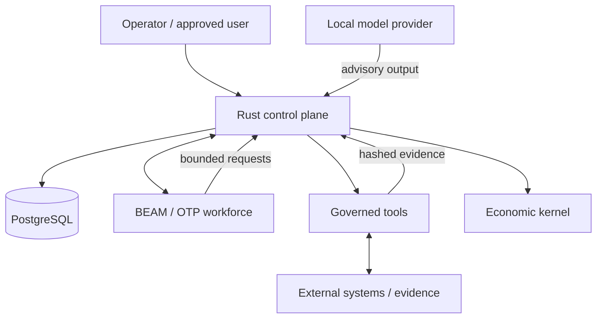

# Architecture

Agent Lifecycle Plane separates **cognition** from **authority**.

A model can propose a plan, summary, diagnosis, or candidate action. It does not become the durable source of truth and it cannot grant itself permissions. The control plane owns identity, capability checks, workflow state, leases, evidence, verification, and economics.

## Trust boundaries

### Rust control plane

The Rust service is the authoritative boundary for:

- principals and capabilities
- task/case/work-item state
- leases and completion transitions
- approval and verification rules
- evidence/artifact provenance
- workflow versions and case pinning
- blueprint import/export policy
- connector registration and secret-reference validation
- budgets, commitments, invoices, payment intents, and journals

### PostgreSQL durable state

The database holds business and execution state independently of any model process. Restarting or replacing a model does not redefine authority or completion.

### BEAM / OTP workforce

The BEAM runtime supervises long-lived agent processes and recovers crashed workers while retaining the same durable principal identities in the control plane.

BEAM supervision is a runtime concern; authorization stays in the Rust control plane.

### Cognition providers

v0.1 supports Ollama and OpenAI-compatible endpoints. Provider output is recorded as advisory model calls. `local_only` refuses non-local model endpoints.

### Governed tool plane

Research fetching is intentionally narrow:

- HTTPS only
- explicit hostname allowlist
- no embedded URL credentials
- standard HTTPS port only
- redirects disabled
- textual MIME types only
- bounded response size
- evidence hash and provenance records

External content is evidence, never authorization.

## Company kernel

Business domains are expressed through shared primitives instead of one runtime per industry:

- workflow definition/version
- case
- work item
- principal/capability
- event
- evidence/artifact
- participant/resource
- supervisor review
- blueprint/mapping/connector
- budget/commitment/invoice/payment intent/journal

The reference-company suite exercises support, procurement, enterprise transition, and project delivery using these same primitives.

## Workflow lifecycle

Workflow versions are immutable. Active cases remain pinned to the version they started with. New design changes create a new version rather than mutating live history.

Work can include agent tasks, decisions, timers, parallel branches, joins, human boundaries, and supervisor review. Completion is determined by durable state and verification—not by an LLM claiming success.

## Integration and replay

Agent Lifecycle Plane treats SAP/Salesforce/ServiceNow/Oracle-style systems as systems of record or external business systems, and MuleSoft/Boomi-style products as transports/integration layers. Canonical mappings identify ownership boundaries rather than hiding them.

Sandbox/shadow replay is simulation-only and must not execute real external side effects.

## Economic boundary

The economic kernel models:

- budgets
- commitments
- receivable/payable invoices
- payment intents
- balanced double-entry journals
- project revenue, expense, and margin

A payment intent can be authorized, but v0.1 does not directly move money. External payment execution remains a separate trusted boundary.

## Runtime classes

The core type system can represent local, Docker, Kubernetes, serverless, edge, and cloud-emulation runtime classes. v0.1's supported product posture is local-first; representation in the type system is not a claim of production support for every runtime class.

## Product boundary

v0.1 is intentionally single-tenant and local-first. Production multi-tenant IAM, HA, public TLS ingress, hardened secrets management, image provenance, and regulatory controls are later deployment concerns rather than claims made by this release.
